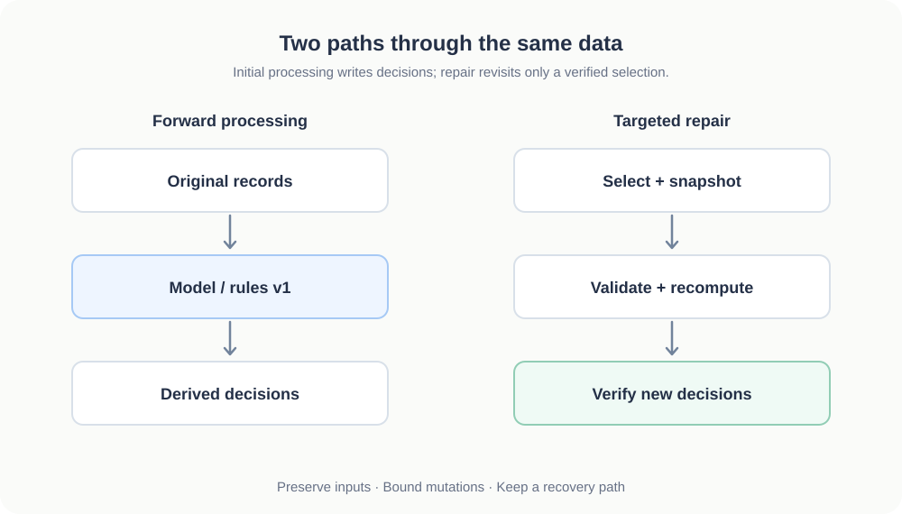
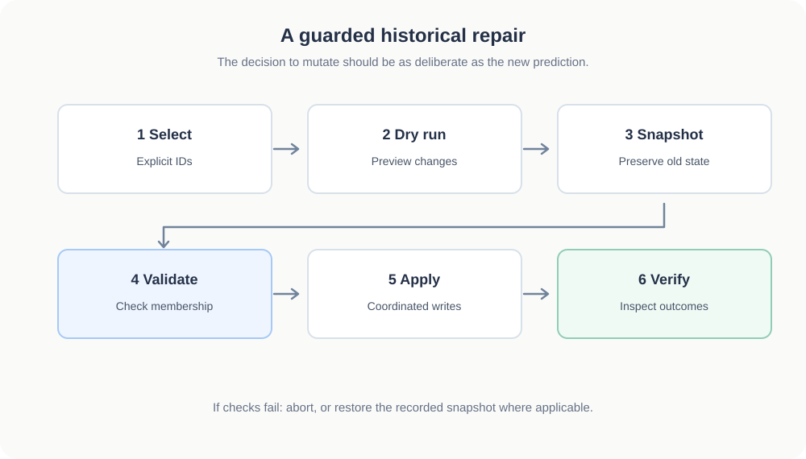

# A Data Pipeline Isn't Finished Until You Can Reprocess It

*When an algorithm changes, yesterday's successful output can become today's data-quality problem. Production pipelines need a way to repair their own history.*

When I started developing the story-grouping system behind [Axon Review](https://axonreview.com), the immediate challenge was deciding which news articles described the same event. But eventually I ran into a harder question: **what happens to all the decisions the system has already made when the grouping logic improves?**

Visual inspection exposed two different failures. Breaking stories that unfolded over several days were fragmented into small clusters, obscuring the larger narrative. Other clusters contained articles that did not belong together. One particularly conspicuous cluster accumulated more than 40 articles and remained contaminated across multiple iterations of the grouper. We eventually addressed it through a more thorough historical repair and backfill process.

The lesson was uncomfortable but useful: a pipeline can complete every job successfully while producing a historical dataset that needs correction.

## Successful processing is not permanent correctness

A classification or clustering result is a decision made under a particular model, rule set, and view of the available evidence. Those conditions change.

A new classifier may handle borderline cases better. A revised story grouper may distinguish separate events that an earlier version merged. New context can also reveal that records previously treated as unrelated belong to the same ongoing story.

If the pipeline only knows how to process new records, every improvement creates an awkward split: new data receives better decisions while old data retains obsolete ones.

That is why reprocessing should be part of the system's design rather than a one-off script written during an incident.

## A backfill is not the same as a safe repair

A **backfill** processes missing or historical records. A **replay** reruns an input stream or a defined portion of it. A **targeted repair** changes selected derived records to correct a known defect. They overlap, but their safety requirements differ.

Simply rerunning an ML job over historical rows can damage a working application. A poorly scoped job might overwrite manually verified labels, create duplicate records, invalidate foreign-key relationships, or change the story identifiers behind persistent links. Even when the model produces reasonable new predictions, the database mutation might be wrong.

Concurrency makes this harder. A background worker may be assigning newly ingested articles while a repair job resets assignments from last week. Both operations could be individually valid yet produce inconsistent shared state if their coordination is inadequate.

I approach these jobs cautiously: limit the selection, preview the intended changes, preserve a recovery path, and coordinate writes with normal processing.

## What a controlled story repair actually needs

The Axon Review codebase provides a concrete example. Its historical story-repair command supports explicitly selected story IDs, a dry-run mode, production confirmation, and an option to apply a previously generated repair plan. The implementation records a digest of the selected data; production application requires matching confirmation values so the operator does not silently act on a different selection.

Its shared repair helpers snapshot article-assignment fields and story-centroid records. Before resetting a targeted story, they revalidate article membership under row locks. The reset and centroid deletion occur in one database transaction. The repair command also acquires a PostgreSQL advisory lock to coordinate with the canonical story-processing workflow and has restoration logic if an applied repair fails.

These mechanisms don't magically guarantee correctness. A dry run can be misleading if live data changes before application, and restoring a snapshot is not the same as making every step of a multi-stage operation atomic. But they convert an ad hoc database edit into a more inspectable process with explicit failure boundaries.

The critical distinction is that **the repair tool must verify what it is allowed to change**, not merely calculate what the new algorithm prefers.

## Idempotency is necessary, but it has limits

I consider idempotency a foundational requirement for data repair: running the same operation again should not multiply its side effects.

In practical terms, a repair should not create another copy of an article every time it runs. It should target stable record identities, distinguish original inputs from derived assignments, and handle already-processed records deliberately.

Yet idempotency alone is not enough. A consistently wrong transformation can be perfectly repeatable. A repair can also be logically idempotent while changing more rows than intended. Safety additionally requires bounded selection, concurrency control, verification, and a way to recover when assumptions break.

## Preserve the source; rebuild the interpretation

My guiding architectural preference is to treat raw ingested records as durable sources of truth and ML predictions, classifications, and clusters as derived state that can be recomputed.

That is a design principle, not a claim that an application's current schema makes every raw field physically immutable. In practice, immutability requires decisions about retention, corrections to bad source data, audit history, and what to do when the upstream source itself changes.

The separation nevertheless matters. If the article text, original URL, publication timestamp, and source provenance survive a model revision, the system has the ingredients to rebuild its interpretation. If those inputs are overwritten along with each prediction, recovery becomes much harder.

I also prefer staged, bounded changes over sweeping repairs. Start with an explicit cohort, exercise the operation against staging data or a suitable backup, inspect the proposed differences, and preserve an artifact describing what was changed. Then verify affected relationships and user-visible behavior after application.

## Recovery is part of the product

The temptation in ML engineering is to focus on the forward path: ingestion, inference, persistence, and the next record. But production systems accumulate history, and history outlives any single model version.

The ability to revise that history safely is a feature. It supports better algorithms without forcing operators to accept permanently incorrect outputs or gamble on broad database rewrites.

My core principle is simple: **keep raw inputs recoverable, treat model outputs as revisable, and make repairs bounded and verifiable.**

A pipeline is not truly finished when it processes a record once. It is finished when the system can explain, revisit, and—when necessary—correct that decision without putting the rest of the application at risk.
