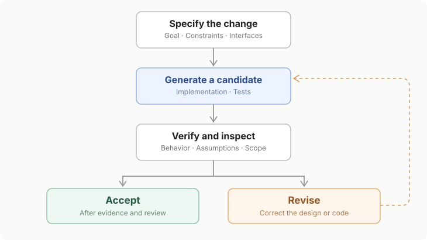

# AI-Assisted Coding Doesn’t Eliminate the Need for Engineering Judgment

*Generating code is increasingly easy. Deciding what to build, recognizing when the implementation is wrong, and keeping the system maintainable are different responsibilities.*

An AI coding agent can produce hundreds of lines of code in seconds. That changes how quickly a developer can move from an idea to a working implementation.

But it also creates an awkward imbalance: **code can be generated much faster than a human can understand or maintain it**.

I’ve experienced both sides while building Axon Review, an AI news intelligence platform with a Python backend and a SvelteKit frontend. Coding assistants helped me move through unfamiliar territory and iterate on complex features. They also required frequent correction, especially when generated code conflicted with the architecture I intended to build.

The lesson wasn’t to stop using AI. It was to become much more deliberate about what I delegate.

## Speed changes the bottleneck

One of the most demanding parts of the backend has been story grouping: deciding which news articles belong to the same unfolding event. It’s a deceptively difficult task. Two articles can discuss the same companies or research area while describing completely different developments.

AI assistance made it possible for me to iterate on the story-clustering implementation repeatedly, rather than spend much longer writing each revision from scratch. That mattered because the challenge was not just producing a clustering module. It was refining the behavior as new edge cases and failure modes became apparent.

The current story-grouping code reflects that complexity. It separates candidate retrieval from event-identity decisions, and the repository contains tests and engineering notes around the system. Those checks matter more to me than the raw number of lines an agent can generate.

**Faster implementation doesn’t remove the need to decide whether the implementation solves the right problem.** It just brings that decision around more often.

## Choosing the stack is part of the engineering

The frontend was a different kind of challenge. I had relatively little experience building production frontends, yet I wanted a responsive interface with reactive filters and multiple views. I chose SvelteKit with Svelte 5 after comparing framework tradeoffs, rather than defaulting to React because of its popularity.

That was a judgment call, not a universal claim that Svelte is better for every project. For this application, I preferred its approach to reactivity and the development experience I expected it to provide.

AI generated the frontend code, but I supplied detailed prompts that functioned almost like informal technical specifications. I decided on the framework and pushed the implementation toward the conventions I wanted to maintain.

That distinction became particularly important with **Svelte 5 runes**. During development, coding assistants sometimes introduced older Svelte patterns into files intended to use the newer reactive approach. I had to identify that drift and explicitly require regenerated code consistent with Svelte 5.

Whether that behavior came from the framework’s relative novelty, the model’s training distribution, or another cause is hard to establish. The practical point is simpler: plausible-looking code can still violate a project’s technical constraints.

Working through those problems also taught me Svelte concepts I might not have learned as quickly from passively accepting generated files. Debugging forced me to understand what the code was actually doing.

## Prompts can be specifications—but they need enforcement

I increasingly treat a coding prompt as a lightweight engineering specification. It should state the objective, relevant constraints, existing interfaces, and what must not change.

For me, the most important decisions to retain are requirements, architecture, and core stack selection. I still use AI to compare options and challenge my assumptions. But I don’t want a code generator quietly changing the system’s direction because another pattern is easier to produce.

That doesn’t mean I insist on manually writing everything else. I regularly delegate the creation of tests, fixtures, harnesses, and deployment steps under my supervision. The division is not “human writes important code, AI writes unimportant code.” Tests and deployment are important, too.

The distinction is **who defines the desired behavior and who accepts the evidence that it works**.

A generated test can reproduce the same mistaken assumption as the generated implementation. A successful build can coexist with an architectural mistake. Verification has to include the requirement itself, not merely whether the code runs.

## The high-velocity technical-debt trap

AI coding enthusiasts sometimes focus on how much faster code can be produced. Critics often focus on the mistakes in the generated code. I think both can miss the accumulated cost of development moving faster than comprehension.

It’s easy to accept an extra abstraction when it arrives already implemented. It’s easy to keep an unnecessary helper, dependency, or configuration layer because removing it takes another round of review. Multiply that across many agent-driven iterations and the codebase can become harder to reason about even as new features appear quickly.

This is where familiar engineering principles become more useful, not less:

- **KISS:** prefer the smallest design that solves the actual problem.
- **YAGNI:** don’t build speculative flexibility for requirements that don’t exist.
- **DRY:** eliminate meaningful duplication without creating abstractions just for their own sake.
- **Modularity:** keep responsibilities and interfaces understandable enough to test and change independently.

I’ve found that the human role increasingly involves pruning. Before asking an agent to add another layer, I want to know why the existing structure can’t handle the requirement.

## An engineering loop, not a code vending machine

The productive workflow is iterative: define a change, generate a candidate implementation, inspect its behavior, test the relevant assumptions, and either accept or revise it.

The crucial point is that **tests support judgment; they don’t replace it**. A suite can be green while the tests are incomplete, the requirements are misunderstood, or the implementation introduces maintenance costs no test was designed to measure.

The same applies to AI-assisted review. A second agent can help inspect a change, but agreement between two models is not independent proof of correctness.

## What changes—and what doesn’t

I don’t think developers need to reject AI coding tools to preserve their skills. In my own case, using AI lowered the friction of exploring an unfamiliar frontend framework and let me iterate on backend ML features faster than I otherwise could have.

But accepting generated code without understanding its role in the system is a poor trade. The developer still has to decide what the software is supposed to do, what constraints matter, and which compromises are acceptable.

As generation becomes cheaper, that responsibility becomes more visible. The limiting resource is no longer just how quickly we can type a function. It’s how clearly we can specify, evaluate, and maintain an evolving system.

My guiding principle is straightforward:

**Own the architecture, delegate the boilerplate, and aggressively enforce simplicity.**

The goal isn’t to maximize the amount of AI-generated code. It’s to ship software whose behavior and complexity you can still defend.
