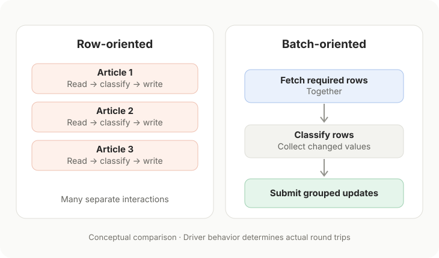
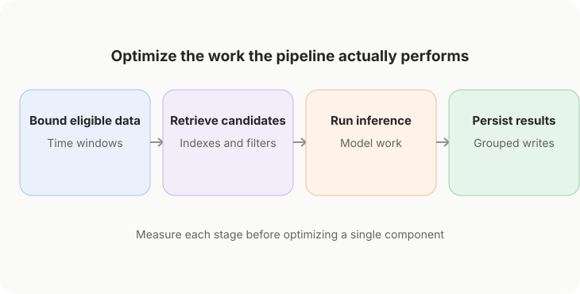

# The Database Bottleneck Hidden Inside an ML Pipeline

*Before optimizing the model, examine how much data the system asks it—and the database—to process.*

It’s natural to start performance work at the most visible part of an ML pipeline: inference. Measure the classifier. Time the embedding model. Look for a faster similarity search.

But the slowest component may be somewhere less interesting: the database reads that assemble a candidate set, or the writes that persist the model’s output.

A fast model cannot rescue a pipeline that repeatedly searches too much data or makes unnecessary trips to its database.

## A batch of records isn’t necessarily a batch of operations

Imagine processing 500 articles. One implementation fetches 500 IDs, loops over them, reads each article separately, computes a prediction, and issues an individual update. We call the overall task a *batch*, but the database still participates in hundreds of small interactions.

Another implementation loads the required rows in one operation, processes the rows in memory, and submits a collection of parameterized updates within a transaction.

The second approach can reduce connection, statement-execution, and transaction-management overhead. But the details matter. Passing multiple parameter dictionaries to SQLAlchemy’s `execute()` is an *executemany-style* operation; it does not guarantee that the driver emits one SQL statement or makes only one network round trip.

The point isn’t that batching is automatically faster. It’s that **the unit of application work and the unit of database work are not necessarily the same**.

## A concrete example from my news pipeline

In [Axon Review](https://axonreview.com), incoming articles go through relevance and topic classification before appearing in a broader news-intelligence workflow.

The codebase contains a row-oriented utility that selects up to 500 unclassified IDs and calls a single-record classification function for each one. That function reads and updates the article individually.

It also contains a `classify_batch()` path. This path fetches the requested article rows together, evaluates their classification state, collects changed values, and submits those updates through one SQLAlchemy `execute()` call with multiple parameter dictionaries inside a transaction.

These are two real implementation patterns, not the results of a benchmark. I haven’t established a measured speedup between them, and the existence of the row-oriented utility doesn’t prove it is a production bottleneck. Still, comparing the paths reveals where avoidable interaction overhead can accumulate.

## The more fundamental boundary: how many rows are eligible?

Writes are only part of the story. A database can spend substantial time identifying *which* records deserve processing.

During development of [Axon Review's](https://axonreview.com) PostgreSQL/Supabase backend, I noticed slow database operations around high-throughput ingestion and story clustering. My observations pointed toward expensive scans and sorts involving large article sets, multi-column filters, and structured entity metadata. I have not isolated those costs in a published benchmark, so I treat them as engineering observations rather than quantified results.

The responses were mostly structural. The schema includes a composite index on `source_type` and `pub_date`, a GIN index on the typed-entity JSONB column, and a partial index supporting versioned story-assignment lookups. Story processing also uses bounded time horizons rather than treating all historical articles as equally eligible candidates.

Those choices serve different purposes:

| Technique | Problem it addresses |
| --- | --- |
| Composite index | Queries filtering on a useful combination of columns |
| GIN index on JSONB | Supported containment and structured-data lookup patterns |
| Partial index | An important subset of rows, without indexing every row indiscriminately |
| Time-windowed candidates | Preventing old or irrelevant data from expanding every retrieval step |

None is a universal optimization. Whether an index is used depends on the actual predicate, selectivity, statistics, and query plan. Indexes also cost storage and make writes more expensive. A time window can improve efficiency while accidentally excluding an older event that still matters.

**The boundary must be justified by the application, not chosen merely to make a benchmark look faster.**

## Measure the whole path, not just the model

I prefer to separate end-to-end time into a few observable stages: fetching eligible records, obtaining any necessary candidate history, executing model inference, writing results, and committing transactions.

For PostgreSQL, `EXPLAIN (ANALYZE, BUFFERS)` can show whether a representative query is performing sequential scans, sorting, or avoidable buffer work. Application timers can help reveal how much elapsed time is actually spent outside the model. Database statistics can identify repeated expensive statements.

Then compare changes using representative data and comparable workloads. A local test against a tiny table may tell a very different story from a remote database with a growing article history.

There are tradeoffs to consider. Large update batches can hold locks longer, increase rollback scope, and consume more memory. The right batch size is something to test—not a magic constant. In many systems, chunked processing and short transactions are more robust than one enormous write.

## An optimization should earn its complexity

My approach is guided by KISS, YAGNI, DRY, and modularity. I’m reluctant to add elaborate caching layers or new abstractions before identifying a bottleneck. But I’m comfortable with targeted structural measures when a known query shape is likely to degrade as data grows.

That means identifying the real access pattern first: the columns being filtered, the ordering required, the amount of history that legitimately matters, and the number of records actually changing.

An optimization earns its place by resolving observed work or preventing a predictable scaling problem without making the system harder to operate.

The lesson I keep returning to is straightforward:

**Bound your data scope before you scale your models.**

A relevance gate, a sensible candidate window, an index aligned with the query, or a grouped write can eliminate work before inference tuning begins. It may not be the glamorous part of machine learning engineering, but it often determines whether the larger system remains manageable as the dataset grows.

Data and feature bloat can quietly overwhelm otherwise capable software. Optimizing the model alone won’t fix an undisciplined data flow.
